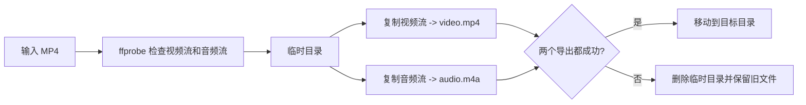

# 设计文档

## 目标

给定一个同时包含视频和音频的 MP4 文件，生成两个独立文件：

1. 仅包含视频流的 MP4。
2. 仅包含音频流的 M4A。

脚本优先保留源编码，避免不必要的转码、质量损失和长时间 CPU 占用。

## 工作流



## 输出映射

| 输出 | FFmpeg 映射 | 编码策略 | 结果 |
| --- | --- | --- | --- |
| `<stem>.video.mp4` | `-map 0:v:0 -an` | `-c:v copy` | 仅视频，保留源视频编码 |
| `<stem>.m4a` | `-map 0:a:0 -vn` | `-c:a copy` | 仅音频，AAC 封装为 M4A |

`0:v:0` 和 `0:a:0` 分别选择第一条视频和第一条音频轨道。`-an`、`-vn` 确保另一类流不会被带入输出。

## 参数说明

- `-c:v copy` / `-c:a copy`：直接复制编码数据，不重新编码。
- `-movflags +faststart`：把 MP4/M4A 的索引移动到文件开头，便于播放器尽快开始读取。
- `--force`：允许覆盖已有目标文件；默认模式拒绝覆盖。
- 临时目录：两个 FFmpeg 命令都成功后才 `mv` 到最终路径，减少失败时留下半成品的风险。

## 文件命名

输入文件名去掉扩展名后作为 `<stem>`。例如：

```text
input:  7月9日丧失清道夫视频.mp4
video:  7月9日丧失清道夫视频.video.mp4
audio:  7月9日丧失清道夫视频.m4a
```

默认输出目录是脚本所在的 `video_tools/`，也可以通过第二个命令行参数指定。

## 错误处理

脚本在以下情况退出并返回非零状态：输入文件不存在、FFmpeg/ffprobe 不可用、输入缺少视频或音频流、输出已存在（除非使用 `--force`），或任一 FFmpeg 命令失败。临时目录通过退出清理逻辑删除；已有目标文件不会在失败时被删除。

## 非目标

- 不负责把 AAC 转成 MP3、WAV 等其他音频编码；需要转码时应单独调用 FFmpeg。
- 不混音、不剪辑、不改变分辨率、不改变帧率。
- 只处理第一条视频和第一条音频轨道；多轨道选择策略后续可扩展为命令行选项。

## 验证策略

- 使用 `bash -n` 检查 Shell 语法，并运行 `--help` 检查参数入口。
- 使用目标 MP4 完整执行脚本，不能只截取样本片段。
- 使用 `ffprobe` 确认 MP4 只有视频流、M4A 只有音频流，且时长与源轨道一致。
- 使用 FFmpeg 完整读取输出文件；任何容器、数据包或解码错误均视为验证失败。
